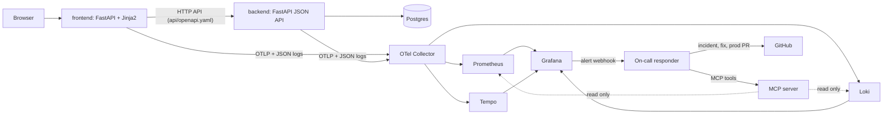

# Para Luego

Interesting things (links, videos, books, products, GitHub repos) end up in a WhatsApp chat with yourself and get forgotten. **Para Luego** ("for later") is a save-it-for-later inbox: save an item in seconds, file it in a category, get a random **Daily** of things to revisit, and share an item with someone through WhatsApp or the clipboard, with a note on why it made you think of them.

It is a course final project and a proof of concept, built end to end with AI coding agents (see [How it was built](#how-it-was-built)). Besides the app, the repo has a full observability stack and an **on-call responder agent** that investigates alerts through an **MCP server** and pushes fixes on its own.

## Live

| Environment | App | Deploys |
|---|---|---|
| dev | https://para-luego-dev-frontend.onrender.com | every green push to `main` |
| prod | https://para-luego-prod-frontend.onrender.com | when a human merges the PR `main` → `prod` |

Both run on Render's free plan: after ~15 idle minutes a service sleeps, and the first page can take about a minute (the app shows "Despertando el servicio…" and reloads by itself). Dev and prod have separate databases (Render Postgres for dev, Neon for prod).

## Features

- **Accounts:** register, log in, log out (session in an `HttpOnly` cookie).
- **Items:** save a link with an optional title and note into a category; list, filter by category, delete.
- **Categories:** five defaults (Leer, Ver, Comprar, Compartir, Proyectos) plus your own.
- **Tu Daily:** one random item per category on the home page, stable for the whole day.
- **Share:** a **WhatsApp** button (prefilled message with title, note and link) and **Copiar** (copies the same text to the clipboard).

The UI is in Spanish.

## Architecture



| Part | What | Docs |
|---|---|---|
| [`api/openapi.yaml`](api/openapi.yaml) | The contract between frontend and backend (contract-first, checked by tests) | |
| [`backend/`](backend/) | JSON API under `/api`, the only code that touches Postgres; Alembic migrations in [`migrations/`](migrations/) | |
| [`frontend/`](frontend/) | Server-rendered pages; talks to the backend only through the API | |
| [`telemetry/`](telemetry/) | OpenTelemetry setup and JSON logs shared by both services | |
| [`observability/`](observability/) | Collector, Prometheus, Tempo, Loki, Grafana (dashboard + alerts) | [README](observability/README.md) |
| [`oncall/mcp_server/`](oncall/mcp_server/) | MCP server with four read-only on-call tools, redaction, audit log | [README](oncall/mcp_server/README.md) |
| [`oncall/agent/`](oncall/agent/) | On-call responder: alert → incident → investigation → fix or hand-off | [README](oncall/agent/README.md) |

## Tech stack

Python 3.12 · FastAPI · Jinja2 · SQLAlchemy + Alembic · Postgres · uv · Docker Compose · OpenTelemetry · Prometheus · Tempo · Loki · Grafana · MCP Python SDK · any OpenAI-compatible LLM · Render (dev, prod) · Neon (prod database) · GitHub Actions · GHCR.

## Run it locally

Prerequisites: Docker (Docker Desktop on Windows/macOS), [uv](https://docs.astral.sh/uv/) and `make` (GNU Make 3.81 or newer).

```bash
make install
```

```bash
make up
```

`make up` builds the images and starts everything, waiting until it's healthy:

| URL | What |
|---|---|
| http://localhost:8000 | The app |
| http://localhost:8001/api/health | Backend API |
| http://localhost:3000 | Grafana, dashboard "Para Luego" (no login locally) |
| http://localhost:9090 · :3200 · :3100 | Prometheus · Tempo · Loki |
| http://localhost:8090/mcp | MCP server (bearer `MCP_TOKEN`) |
| http://localhost:8080/alerts | On-call responder's webhook |

Grafana, Prometheus, Tempo, Loki, the MCP server and the responder listen on 127.0.0.1 only.

`make down` stops it (the database volume is kept). `make logs` follows the app's logs; plain `make` lists every target.

A `.env` file is optional: without it, local defaults are used and the responder only logs alerts. Copy [`.env.example`](.env.example) to `.env` to change ports or to give the responder its keys (`GITHUB_TOKEN`, `LLM_API_KEY`; see the [responder's README](oncall/agent/README.md)). Never commit `.env`.

## Tests and CI

| Suite | Command | What |
|---|---|---|
| Unit | `make test-unit` | Pure logic: Daily, share text, config, redaction, log format, responder (with fakes) |
| Frontend | `make test-frontend` | Rendered pages and flows, backend faked from the contract |
| Contract | `make test-contract` | Backend routes and the frontend client against `api/openapi.yaml` |
| Integration | `make test-integration` | The API against a real Postgres (a throwaway container on port 5433) |

`make test` runs all four (needs Docker), `make lint` runs ruff, `make security` runs bandit and pip-audit. [CI](.github/workflows/ci.yml) runs install, lint, security, tests and the Docker build on every PR and on pushes to `main` and `prod`; `make ci-local` runs the same workflow locally with `act`. Testing approach: [`_docs/testing-guidelines.md`](_docs/testing-guidelines.md).

## Deploy

```
PR → CI → merge to main → CI → CD dev (build image, deploy to Render dev, wait for the version)
make promote-prod → PR main → prod → a human merges → CI → Deploy prod (same image dev ran)
```

- The image is built once per commit (`ghcr.io/davbaster/ai-dev-tools-project:<sha>`); prod deploys exactly the image dev ran.
- `/health` and `/api/health` report the deployed commit SHA.
- Rollback: the **Rollback** workflow or `make rollback ENV=<dev|prod> TAG=<sha>`.
- `prod` is protected (PR + CI); production only changes through a human-merged PR.

Details, Render's free-plan limits and the one-time setup: [`_docs/deploy.md`](_docs/deploy.md).

## Observability and on-call

**Observability.** Every log line is JSON with `trace_id` and `span_id`. Saving an item is one trace from the frontend through the backend to the database. Metrics are labeled by route template (never raw paths), and no customer data reaches telemetry: no usernames, URLs, titles or notes. Grafana links a log line to its trace and back. Two alerts watch what users feel: **SaveItemFailing** and **HighServerErrors** (5xx over 5% in 5 minutes). This runs locally; Render exports nothing. → [`observability/README.md`](observability/README.md)

**On-call.** Grafana's alert webhook wakes the **responder**, which:

1. opens a GitHub issue labeled `incident`;
2. investigates through the **MCP server**'s read-only tools (`get_recent_logs`, `query_metrics`, `check_health`, `read_source_file`; every result redacted, every call audited) with an LLM;
3. either pushes a minimal fix plus a test to `main`, after running ruff and the tests on a copy of the repo, and opens the PR to `prod`; or labels the incident `needs-human` with what it checked.

It never merges, deploys or restarts anything. Pushing is off unless `RESPONDER_ALLOW_PUSH=true`. You can also connect your own MCP client, e.g. Claude Code, to the same tools. → [`oncall/mcp_server/README.md`](oncall/mcp_server/README.md), [`oncall/agent/README.md`](oncall/agent/README.md)

## Demo

1. Use the public dev app: register, save items, see the Daily, share with WhatsApp and Copiar.
2. Locally: `make up`, open Grafana, follow a save from its log line to its trace.
3. `make demo-on` turns on a flagged bug (titles over 40 characters fail). The alert fires, the responder opens an incident, finds the bug and pushes a fix to `main`.
4. CI passes, CD deploys to dev, the alert resolves; a human merges the PR `main` → `prod`.

Step by step, with timings: [`_docs/demo.md`](_docs/demo.md).

## How it was built

The project was planned, groomed, implemented, tested and deployed by AI agents under one human owner, following written rules that any LLM tool can read:

- **[`AGENTS.md`](AGENTS.md)** is the single instruction file for every tool (Claude Code, Codex, VS Code agents…): layout, commands, rules for the contract, telemetry, security, git and the on-call agent. [`CLAUDE.md`](CLAUDE.md) only points to it.
- **Roles** ([`_docs/team.md`](_docs/team.md), prompts in [`_docs/agents/`](_docs/agents/)): an orchestrator, a PM who grooms each issue into checkable acceptance criteria, a software engineer, a QA engineer who posts `## QA: PASS` or `## QA: FAIL`, and the runtime on-call responder.
- **Process** ([`_docs/process.md`](_docs/process.md)): every task is a GitHub issue. The PM grooms it; the human approves it and any new dependency; the engineer works on a branch and opens a PR; QA verifies each criterion; a PR merges only with green CI, QA PASS and the human's OK.
- **Memory between sessions:** [`HANDOFF.md`](HANDOFF.md) is the "where are we" snapshot and [`_docs/log/`](_docs/log/) the append-only daily log (what was done, decisions and why, open threads, errors). The plan is [`_docs/plan.md`](_docs/plan.md).

For an example of the trail, see issue [#17](https://github.com/davbaster/ai-dev-tools-project/issues/17) (the responder): grooming, approval, implementation, a live QA that found and fixed three problems, and the merge.

## Project layout

```
api/            OpenAPI contract
backend/        JSON API (+ migrations/)
frontend/       pages and the API client
telemetry/      OpenTelemetry + JSON logs
observability/  collector, Prometheus, Tempo, Loki, Grafana
oncall/         mcp_server/ and agent/
tests/          unit/, frontend/, contract/, integration/
_docs/          plan, process, team, roles, deploy, demo, log
.github/        CI, CD dev, Deploy prod, Rollback
```

Every command goes through the [`Makefile`](Makefile); [`AGENTS.md`](AGENTS.md) explains each target.

## Known limitations and next steps

- **Free plan:** services sleep after ~15 minutes, and the dev database expires on 2026-12-08 ([#43](https://github.com/davbaster/ai-dev-tools-project/issues/43)).
- **Not built:** the admin panel and the cloud demo mode, where Render would show status-code counts and wake the responder in-process ([#18](https://github.com/davbaster/ai-dev-tools-project/issues/18)). Observability and the responder run locally only.
- **Responder:** one root cause can open two incidents ([#62](https://github.com/davbaster/ai-dev-tools-project/issues/62)). Rolling back across database migrations isn't handled ([#42](https://github.com/davbaster/ai-dev-tools-project/issues/42)).
- **Other follow-ups:** in the [backlog](https://github.com/davbaster/ai-dev-tools-project/issues?q=is%3Aissue+is%3Aopen+label%3Abacklog), e.g. login rate limiting, renaming categories, editing items.
